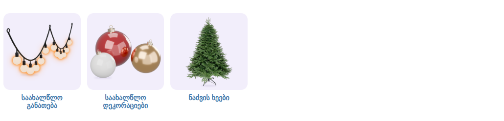

# საახალწლო — ქვეკატეგორიების ბანერები

კატეგორია: [საახალწლო](https://superi.ge/saakhaltslo/) · 800×800 PNG · სტილი: [../README.md](../README.md)

თითო ბარათზე ერთი პროდუქტი. პალიტრა: თბილი ოქროსფერი შუქი, ბორდოსფერი, ოქროსფერი და მარგალიტისფერი სათამაშოები, მწვანე ნაძვის ხე.

საიტის სტილით, [`subcategory-grid.css`](../subcategory-grid.css)-ით:

| ფაილი | ქვეკატეგორია | პროდუქტი |
|---|---|---|
| `01-saakhaltslo-ganateba.png` | [საახალწლო განათება](https://superi.ge/saakhaltslo-ganateba/) | თბილი ნათების ბურთულებიანი გირლიანდა — 3D სტუდიური რენდერი |
| `02-saakhaltslo-dekoraciebi.png` | [საახალწლო დეკორაციები](https://superi.ge/saakhaltslo-dekoraciebi/) | ნაძვის ხის სათამაშოები (ბორდოსფერი, ოქროსფერი, მარგალიტისფერი) — 3D სტუდიური რენდერი |
| `03-nadzvis-kheebi.png` | [ნაძვის ხეები](https://superi.ge/nadzvis-kheebi/) | ნაძვის ხე BABI 210 სმ, შერეული სილიკონის წიწვით (superi.ge-დან) |

განათებისა და დეკორაციების კატეგორიებში საიტზე მხოლოდ გირლიანდების კოლოფების (დიდი წარწერებით) და ინტერიერში გადაღებული ფოტოებია, რომლებიც სუფთად ვერ ამოიჭრება.
ამიტომ ეს ორი Blender-ით არის დახატული: [`../tools/render_newyear.py`](../tools/render_newyear.py), რენდერები [`src/`](src/)-შია. წყაროები: [banners.json](banners.json).
