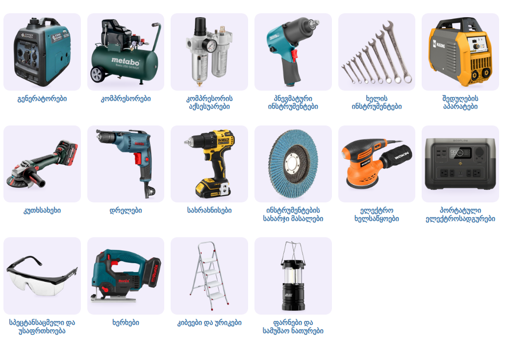

# სამშენებლო ხელსაწყოები — ქვეკატეგორიების ბანერები

კატეგორია: [სამშენებლო ხელსაწყოები](https://superi.ge/samsheneblo-khelsatskoebi/) · 800×800 PNG · სტილი: [../README.md](../README.md)

თანამედროვე, დახვეწილი მოდელები, თითო ბარათზე ერთი პროდუქტი; არცერთი არ იმეორებს საიტზე ახლა დადებულ ფოტოებს
(ყვითელი ღია ჩარჩოიანი გენერატორი, Tolsen-ის კომპრესორი, ინსტრუმენტების ნაკრები, Bosch-ის კუთხსახეხი).
პალიტრა მშვიდია: გრაფიტი, ფირუზისფერი, მუქი მწვანე და ვერცხლისფერი.

საიტის სტილით, [`subcategory-grid.css`](../subcategory-grid.css)-ით:

| ფაილი | ქვეკატეგორია | პროდუქტი (superi.ge-დან) |
|---|---|---|
| `01-generatorebi.png` | [გენერატორები](https://superi.ge/generatorebi/) | გენერატორი ინვერტორული Könner & Söhnen KS 2100i S |
| `02-kompresorebi.png` | [კომპრესორები](https://superi.ge/kompresorebi/) | ჰაერის კომპრესორი Metabo BASIC 250-50 W OF (50 ლ) |
| `03-kompresoris-aqsesuarebi.png` | [კომპრესორის აქსესუარები](https://superi.ge/kompresoris-aqsesuarebi/) | ჰაერის ფილტრ-რეგულატორი ორმაგი Ronix RH-6902 |
| `04-pnevmaturi-instrumentebi.png` | [პნევმატური ინსტრუმენტები](https://superi.ge/pnevmaturi-instrumentebi/) | პნევმატური დარტყმითი ქანჩის გასაღები Ronix RA-1201 |
| `05-khelis-instrumentebi.png` | [ხელის ინსტრუმენტები](https://superi.ge/khelis-instrumentebi/) | ქანჩის გასაღების ნაკრები Topstrong 235125 (12 ც) |
| `06-shedughebis-aparatebi.png` | [შედუღების აპარატები](https://superi.ge/shedughebis-aparatebi/) | შედუღების აპარატი HUGONG ESTICK 200 PFC III |
| `07-kutkhsakhekhebi.png` | [კუთხსახეხი](https://superi.ge/kutkhsakhekhebi/) | აკუმულატორული კუთხსახეხი Metabo WVB 18 LT, 125 მმ |
| `08-drelebi.png` | [დრელები](https://superi.ge/drelebi/) | დრელი ელექტრო Ronix 2115, 420 W |
| `09-sakhrakhnisebi.png` | [სახრახნისები](https://superi.ge/sakhrakhnisebi/) | სახრახნისი აკუმულატორული DeWALT DCD708S2T-QW, 18 V |
| `10-instrumentebis-sakharji-masalebi.png` | [ინსტრუმენტების სახარჯი მასალები](https://superi.ge/instrumentebis-sakharji-masalebi/) | სახეხი ფურცლოვანი დისკი WOKIN 115 მმ |
| `11-elektro-khelsatsyoebi.png` | [ელექტრო ხელსაწყოები](https://superi.ge/elektro-khelsatsyoebi/) | ექსცენტრიკული საპრიალებელი Wokin 788305, 125 მმ |
| `12-portatuli-eleqtrosadgurebi.png` | [პორტატული ელექტროსადგურები](https://superi.ge/portatuli-eleqtrosadgurebi/) | პორტატული ელექტროსადგური EcoFlow River 2 Max |
| `13-spetstansatsmeli-da-usafrtkhoeba.png` | [სპეცტანსაცმელი და უსაფრთხოება](https://superi.ge/spetstansatsmeli-da-usafrtkhoeba/) | დამცავი სათვალე WOKIN 455000 |
| `14-kherkhebi.png` | [ხერხები](https://superi.ge/kherkhebi/) | უსადენო ბეწვა ხერხი Ronix 8608, 20 V |
| `15-kibeebi-da-urikebi.png` | [კიბეები და ურიკები](https://superi.ge/kibeebi-da-urikebi/) | კიბე SARAYLI Practical 4, 4 საფეხური |
| `16-farnebi-da-samushao-naturebi.png` | [ფარნები და სამუშაო ნათურები](https://superi.ge/farnebi-da-samushao-naturebi/) | სალაშქრო ფარანი 2E PLBL3AAF, დასაკეცი, 200 ლმ |

დისკის, საპრიალებლისა და სათვალის ფოტოებიდან WOKIN-ის ლოგო წაშლილია (`"erase"`). წყაროები: [banners.json](banners.json).
