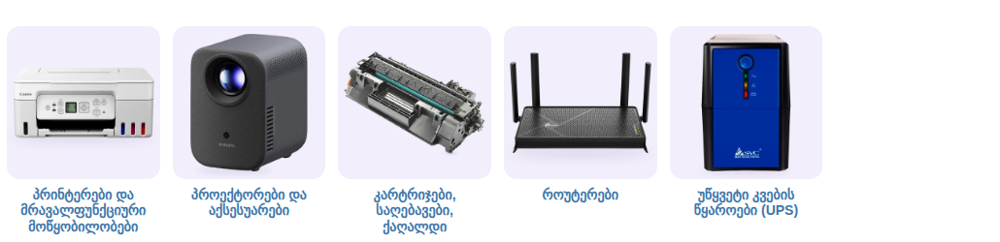

# საოფისე და ქსელური მოწყობილობები — ქვეკატეგორიების ბანერები

კატეგორია: [საოფისე და ქსელური მოწყობილობები](https://superi.ge/saopise-da-qseluri-motskobilobebi/) · 800×800 PNG · სტილი: [../README.md](../README.md)

თანამედროვე, მშვიდი დიზაინის პროდუქტები superi.ge-ს ახლანდელი ასორტიმენტიდან, თითო ბარათზე ერთი.

საიტის სტილით, [`subcategory-grid.css`](../subcategory-grid.css)-ით:

| ფაილი | ქვეკატეგორია | პროდუქტი (superi.ge-დან) |
|---|---|---|
| `01-printerebi.png` | [პრინტერები და მრავალფუნქციური მოწყობილობები](https://superi.ge/printerebi/) | Canon PIXMA G3470 (5805C029AA) White |
| `02-proeqtorebi-da-aqsesuarebi.png` | [პროექტორები და აქსესუარები](https://superi.ge/proeqtorebi-da-aqsesuarebi/) | Xiaomi Smart Projector L1 Black |
| `03-kartrijebi-saghebavebi-qaghaldi.png` | [კარტრიჯები, საღებავები, ქაღალდი](https://superi.ge/kartrijebi-saghebavebi-qaghaldi/) | PrinterMayin CE505X/CF280X |
| `04-routerebi.png` | [როუტერები](https://superi.ge/routerebi/) | TP-Link Archer BE230 Dual-Band Wi-Fi 7 Router |
| `05-utsyveti-kvebis-tsyaroebi-ups.png` | [უწყვეტი კვების წყაროები (UPS)](https://superi.ge/utsyveti-kvebis-tsyaroebi-ups/) | SVC V-650, 650 VA / 360 W, Line-Interactive, AVR |

UPS-ებიდან საიტზე ერთადერთი სამაგიდო მოდელია (SVC V-650); დანარჩენი სტოიკისაა. წყაროები: [banners.json](banners.json).
