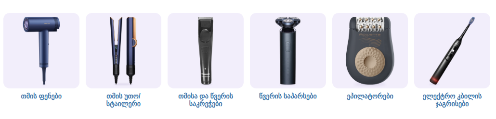

# სილამაზე და მოვლა — ქვეკატეგორიების ბანერები

კატეგორია: [სილამაზე და მოვლა](https://superi.ge/silamaze-da-movla/) · 800×800 PNG · სტილი: [../README.md](../README.md)

მშვიდი პალიტრა (მუქი ლურჯი, შავი, ოქროსფერი), რომ Dyson-ის სტაილერს ერთ ხაზზე ედგას. თითო ბარათზე ერთი პროდუქტი.

საიტის სტილით, [`subcategory-grid.css`](../subcategory-grid.css)-ით:

| ფაილი | ქვეკატეგორია | პროდუქტი (superi.ge-დან) |
|---|---|---|
| `01-tmis-fenebi.png` | [თმის ფენები](https://superi.ge/tmis-fenebi/) | Philips Series 8000 BHD839/00, ადრიატიკული ლურჯი |
| `03-tmisa-da-tsveris-sakrechebi.png` | [თმისა და წვერის საკრეჭები](https://superi.ge/tmisa-da-tsveris-sakrechebi/) | Panasonic ER-GP21-K820, შავი |
| `04-tsveris-saparsebi.png` | [წვერის საპარსები](https://superi.ge/tsveris-saparsebi/) | Xiaomi Mi Electric Shaver S700 Black |
| `05-epilatorebi.png` | [ეპილატორები](https://superi.ge/epilatorebi/) | Rowenta Easy Touch EP1119F0, შავი / ოქროსფერი |
| `06-eleqtro-kbilis-jagrisebi.png` | [ელექტრო კბილის ჯაგრისები](https://superi.ge/eleqtro-kbilis-jagrisebi/) | Philips Sonicare Advanced Clean HX3792/11, შავი |

„თმის უთო/სტაილერი" (Dyson Airstrait) უკვე გაკეთებულია: [../tsvrili-sakopatskhovrebo-teqnika/05-tmis-uto-staileri.png](../tsvrili-sakopatskhovrebo-teqnika/05-tmis-uto-staileri.png).
ფენის ფოტოდან გვერდზე დადებული საქშენი წაშლილია (`"erase"`), ჯაგრისი დახრილია (`"rotate"`). წყაროები: [banners.json](banners.json).
