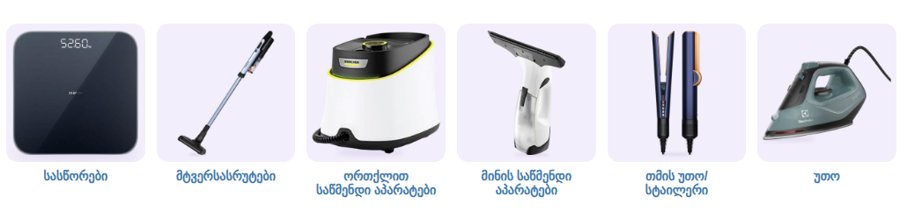

# წვრილი საყოფაცხოვრებო ტექნიკა — ქვეკატეგორიების ბანერები

კატეგორია: [წვრილი საყოფაცხოვრებო ტექნიკა](https://superi.ge/tsvrili-sakopatskhovrebo-teqnika/) · 800×800 PNG · სტილი: [../README.md](../README.md)

თანამედროვე, მშვიდი დიზაინის პროდუქტები superi.ge-ს ახლანდელი ასორტიმენტიდან, თითო ბარათზე ერთი.

საიტის სტილით, [`subcategory-grid.css`](../subcategory-grid.css)-ით:

| ფაილი | ქვეკატეგორია | პროდუქტი (superi.ge-დან) |
|---|---|---|
| `01-sastsorebi.png` | [სასწორები](https://superi.ge/sastsorebi/) | Xiaomi Smart Scale S200 Dark grey |
| `02-mtversasrutebi.png` | [მტვერსასრუტები](https://superi.ge/mtversasrutebi/) | HITACHI PV-XHE4PLMBCEU |
| `03-ortqlit-satsmendi-aparatebi.png` | [ორთქლით საწმენდი აპარატები](https://superi.ge/ortqlit-satsmendi-aparatebi/) | KARCHER SC 3 Deluxe EasyFix |
| `04-minis-satsmendi-aparatebi.png` | [მინის საწმენდი აპარატები](https://superi.ge/minis-satsmendi-aparatebi/) | KARCHER WV 2 Plus N |
| `05-tmis-uto-staileri.png` | [თმის უთო/სტაილერი](https://superi.ge/tmis-utoebi-da-stailerebi/) | Dyson Airstrait™ HT01 straightener Prussia |
| `06-uto.png` | [უთო](https://superi.ge/utoebi/) | Electrolux E5SI2-6OG |

Kärcher-ის ფოტოებზე მთელი ნაკრები იყო გაშლილი, ამიტომ მხოლოდ მთავარი აპარატი დავტოვე (`"crop"`, `"erase"`).
მტვერსასრუტი ოდნავ დახრილია (`"rotate"`), რომ ბარათი უკეთ შეავსოს. წყაროები: [banners.json](banners.json).
